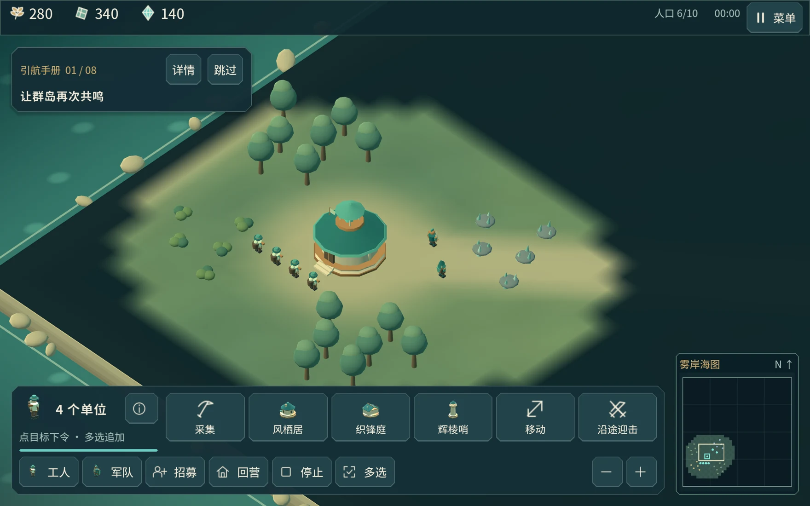

# 岚汐纪：潮晶之争

原创风格化 3D 单人即时战略游戏。指挥雾岸同盟采集穗粮、枝材与岚晶，建设营地，训练军队，在迷雾中探索并对抗 AI。



[嘉文的作品集](https://oyjw140814.github.io/)

## 运行

使用 **Godot 4.7.2** 或兼容的 Godot 4 版本，导入根目录 `project.godot`，等待资源导入后运行主场景。不需要安装 Houdini。

```sh
godot --editor --path .
```

## 已有玩法

- 资源采集、建筑施工、真实经济与生产队列。
- 工人、盾卫、射手、枪卫、骑士和攻坚单位。
- 兵种克制、迷雾、AI 对手、胜负结算。
- 中文教学、游玩说明、本地存档和设置。
- 雾海奇幻 UI、图标网格、招募界面和 125% 大字模式。

## 工程结构

- `scripts/` 游戏逻辑和规则数据。
- `scenes/`、`shaders/` 和 `assets/` 场景、着色器与资产。
- `tests/` 规则检查。
- `docs/` 中文说明、制作流程与验证记录。
- `houdini/` 程序化资产工作流。该工作流尚未在 Houdini 中执行验证。

## 范围

当前为第一阶段可玩的单人开发版本，包含部分后续美术与界面优化。手机平台构建和真机验证尚未完成；没有多人联机、真实账号或内购。

此仓库保存当前主工程，未自动合并本机七个隔离开发副本的功能。独立副本中的段位系统和性能数据不应视作主工程已经集成的功能。

公开源码不含 Godot 导入缓存、macOS 二进制 APP 或个人存档。各素材和字体的来源见 [素材来源与许可](docs/素材来源与许可.md)。

作者：嘉文（oyjw140814），使用 AI 辅助设计与开发。
